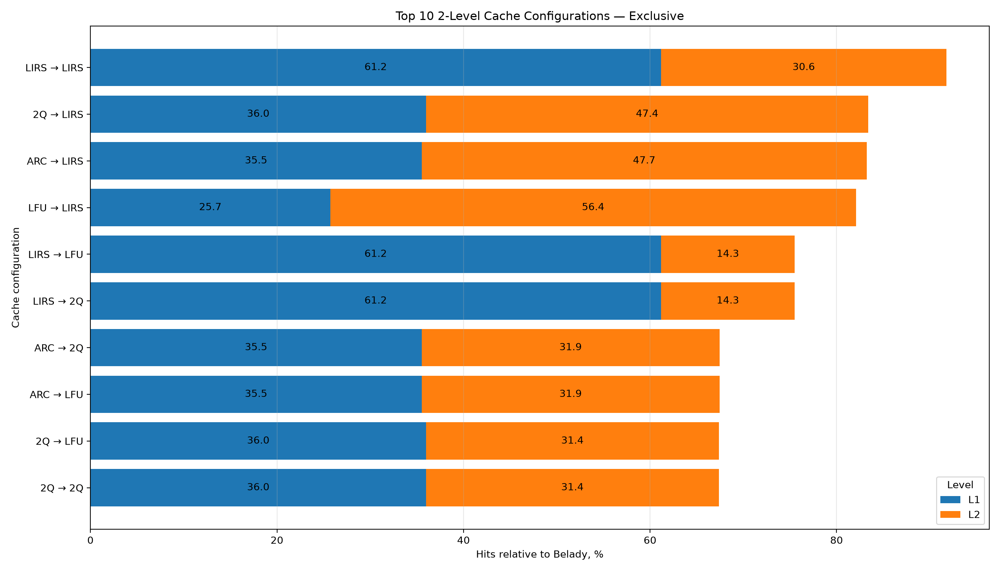
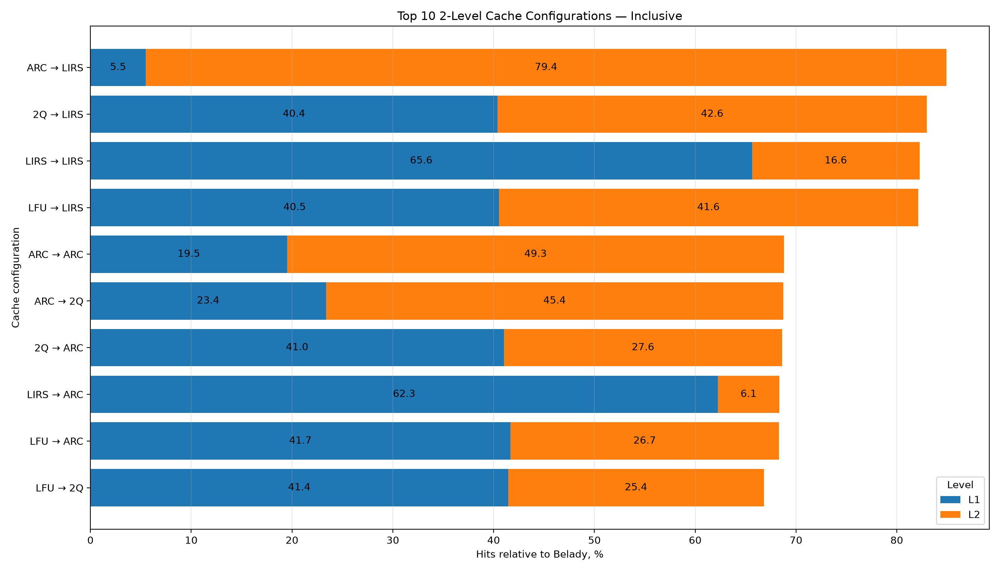
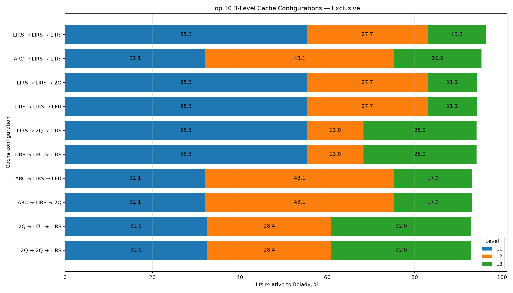
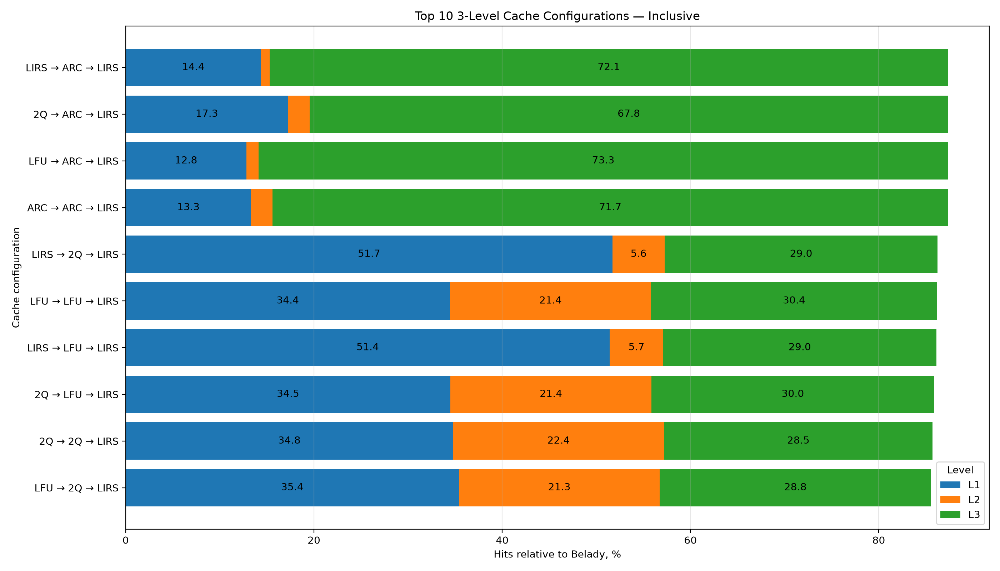
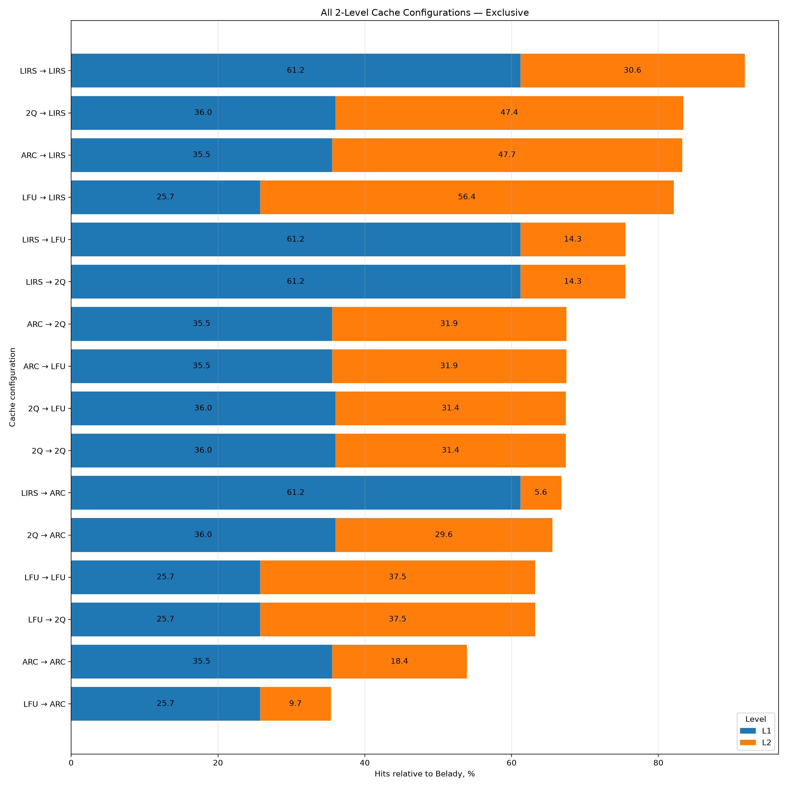
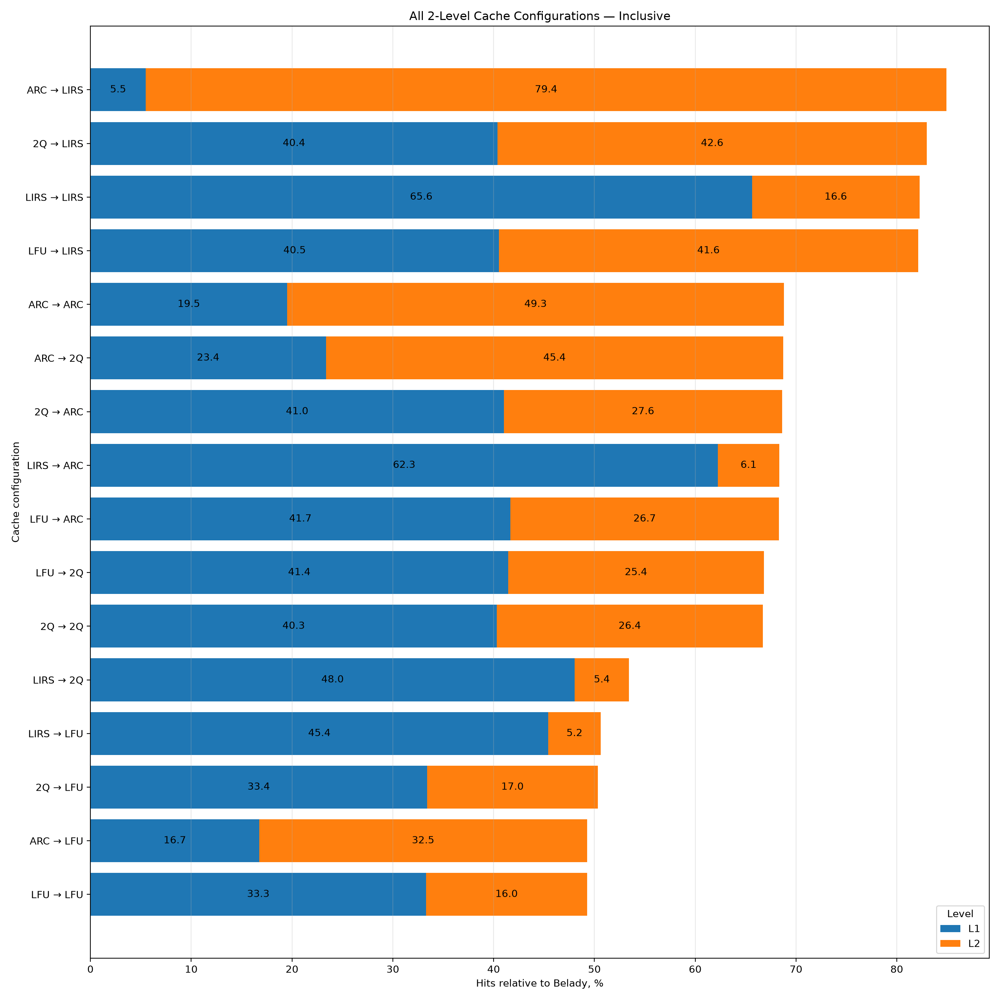
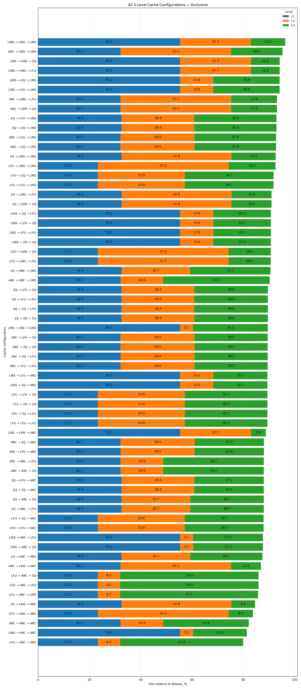
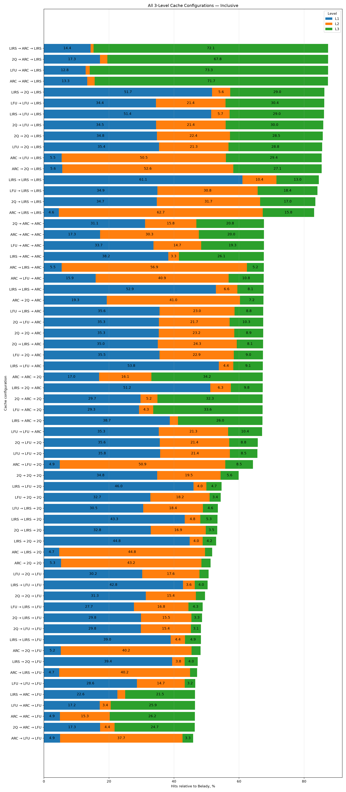
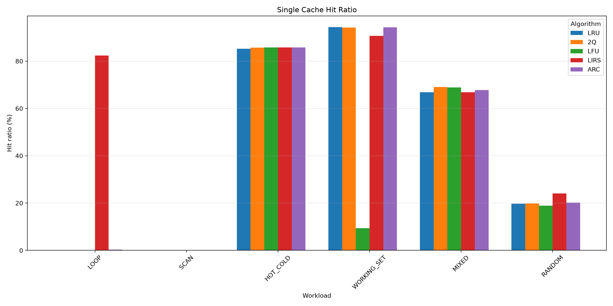

# Cache Simulator

A C++ cache simulator implementing five eviction algorithms and multi-level cache organization.

## Features

- LRU — Least Recently Used
- LFU — Least Frequently Used
- 2Q — Two Queues
- ARC — Adaptive Replacement Cache
- LIRS — Low Inter-reference Recency Set
- Single-level and multi-level caches
- Arbitrary number of cache levels
- Exclusive and Inclusive multi-level cache organization
- Counting `Hits` and `Misses` for each level
- Slow memory modeling
- Benchmarks for various cache configurations
- Comparison with the optimal Belady algorithm
- Plotting the results

## Project Structure

To view the project structure, run the command:

```bash
tree -I build
```

## Build

### Requirements

- A C++ compiler supporting C++17 (e.g., GCC or Clang).
- CMake version 3.16 or newer.
- Google Test for building and running tests.
- To plot graphs, install the dependencies written in requirements.txt:

### Running the Application

The application executable is located at `build/cache_app`.

## Benchmarks

### Results

- `benchmarks/benchmarks.csv` — measurement results.
- `benchmarks/plots/` — directory containing generated plots.

## Running the Simulator

By default, the program uses the file:

    txt/input.txt

You can also provide a custom input file:

## Input File Format

The first line contains the number of cache levels.

Then, for each level, the algorithm and cache size are specified:

    <algorithm> <capacity>

After describing all levels, the sequence of page requests follows.

Example:

    3
    lru 10
    arc 20
    lirs 30
    1 2 3 4 5 1 2 6 7 1 8 9 2 3

In this example, a three-level cache is created:

    L1: LRU  — capacity 10
    L2: ARC  — capacity 20
    L3: LIRS — capacity 30

The cache capacity must be positive.

## Multi-level Cache

In a multi-level cache, a request checks the levels sequentially:

    request
       |
       v
      L1
       |
     miss
       v
      L2
       |
     miss
       v
      L3
       |
     miss
       v
    slow memory

If a page is not found at any level, it is loaded from slow memory.

The project supports two ways to organize a multi-level cache:

- Exclusive
- Inclusive

## Exclusive

In **Exclusive** mode, a page physically resides on only one cache level at a time.

For example:

    L1: [1 2 3]
    L2: [4 5 6]
    L3: [7 8 9]

If page `5` is found in L2, it is moved to L1:

    L2 → L1

If an eviction occurs during insertion into L1, the evicted page is passed down to the next level:

    L1 → L2 → L3

Thus, a single page is not stored simultaneously on multiple levels.

The advantage of this approach is that the total capacity of the levels is utilized without duplicating pages.

## Inclusive

In **Inclusive** mode, lower levels contain copies of pages from upper levels.

For three levels, the invariant holds:

    L1 ⊆ L2 ⊆ L3

For example:

    L1: [1 2]
    L2: [1 2 3 4]
    L3: [1 2 3 4 5 6]

If a page is found at a lower level, it may be promoted to upper levels.

If a page is evicted from a lower level, the corresponding copies of this page in upper levels are removed.

## Cache Algorithms

### LRU

**Least Recently Used**

Evicts the page that has not been used for the longest time.

https://dev.to/abdullahyasir/understanding-lru-cache-efficient-data-storage-and-retrieval-2jnc

### LFU

**Least Frequently Used**

Evicts the page with the lowest access frequency.

https://www.geeksforgeeks.org/dsa/least-frequently-used-lfu-cache-implementation/

### 2Q

**Two Queues**

Uses multiple queues to separate recently added pages from frequently used pages.

https://arpitbhayani.me/blogs/2q-cache/

https://www.vldb.org/conf/1994/P439.PDF

### ARC

**Adaptive Replacement Cache**

Adaptively balances between recently used and frequently used pages.

https://www.mydreams.cz/en/hosting-wiki/11161-arc-cache-advanced-memory-management-in-zfs.html

https://www.usenix.org/conference/fast-03/arc-self-tuning-low-overhead-replacement-cache


### LIRS

**Low Inter-reference Recency Set**

https://ranger.uta.edu/~sjiang/pubs/papers/jiang02_LIRS.pdf

https://redis.io/glossary/lru-cache/

Uses information about the distance between page accesses to determine which pages should be retained in the cache.

## Statistics

Separate statistics are maintained for each level.

The following are counted:

- `Hits` — number of hits;
- `Misses` — number of misses.

Example:

    L1:
        Hits: 120
        Misses: 80

    L2:
        Hits: 50
        Misses: 30

    L3:
        Hits: 10
        Misses: 20

You can also print the current contents of the cache levels.

## Slow Memory

If the requested page is missing from all cache levels, it is loaded from slow memory.

Slow memory is modeled inside `multi_cache_t`.

A corresponding value is stored for each page, ensuring that repeated requests to the same page receive the same value.

## Benchmarks

A dedicated benchmarking system is implemented for performance research.

Considered scenarios:

- Single-level caches;
- Two-level caches;
- Three-level caches;
- Exclusive organization;
- Inclusive organization;
- Various combinations of algorithms across levels.

The following workloads are used:

    LOOP
    SCAN
    HOT_COLD
    WORKING_SET
    MIXED
    RANDOM

The CSV contains information about:

- Cache configuration;
- Algorithms at each level;
- Organization mode;
- Number of hits;
- Hit ratio;
- Belady result;
- Efficiency;
- Number of hits at each level.

## Research Results

### Experimental Methodology

To evaluate cache algorithms, experiments were conducted with the algorithms listed above.

The study was performed for single-level caches, as well as two- and three-level configurations. For multi-level caches, Exclusive and Inclusive organization schemes were considered.

### Workloads

For each workload type, **5,000 requests** are generated. Generator parameters are fixed, making the results reproducible.

| Workload | Parameters | Description |
|---|---|---|
| `LOOP` | 5,000 requests, working set — **35 pages** | Sequential cyclic access to pages `0..34`. The working set is slightly larger than the total cache capacity, so the workload clearly demonstrates algorithm behavior under cyclic eviction. |
| `SCAN` | 5,000 requests, **5,000 unique pages** | Each page is requested once sequentially: `0, 1, 2, ...`. There are no repeated requests. |
| `HOT_COLD` | **15 hot** + **500 cold** pages, hot page probability — **85%** | 85% of requests target a small set of frequently used pages, while the remaining 15% target a large set of rarely used pages. |
| `WORKING_SET` | working set — **25 pages**, shift every **250 requests** | Approximately 25 pages are active at any given time. After every 250 requests, the working set shifts by 12 pages. |
| `MIXED` | blocks of **100 requests**, 3 phase types | Alternating cyclic load of 15 pages, predominantly hot accesses to a range of up to 100 pages, and random accesses to a range of up to 300 pages. |
| `RANDOM` | **5,000 requests**, range — **150 pages**, seed = **42** | Uniformly random sequence of requests to 150 pages. |

For all multi-level configurations, the following sizes are used:

- **L1 = 10 pages**
- **L2 = 20 pages**
- **L3 = 30 pages**

For single-level caches, a capacity of **30 pages** is used.
The optimal **Belady** algorithm was used as a baseline. The main metrics were:

- `Hits` — total number of hits;
- `Hit_Ratio_Pct` — hit ratio percentage;
- `Ideal_Hits` — number of hits by the optimal Belady cache;
- `Efficiency_Pct` — efficiency relative to Belady;
- `L1_Hits`, `L2_Hits`, `L3_Hits` — number of hits at each level.

For multi-level caches, the distribution of hits across levels was additionally analyzed. This makes it possible to evaluate not only the total number of hits, but also the specific level at which they occur.

### Multi-level Configuration Ranking

The most intuitive indicator for comparing configurations is total efficiency relative to Belady. Below are the top ten two- and three-level configurations for each cache organization scheme, based on the average number of hits across all workload variants.









In the charts, each bar is broken down into L1, L2, and L3 segments. Thus, the height of the bar shows the configuration's total contribution relative to Belady, while the individual segments show where exactly the hits were obtained.

### All Configurations

To analyze the impact of a specific algorithm and its position in the hierarchy, plots were also generated for all studied configurations.









These charts allow comparison not only of the leading configurations, but of the entire set of algorithm combinations.

### Single-Level Caches



The results show that algorithm efficiency depends heavily on the nature of the workload.

On `WORKING_SET`, **LRU** proved to be the best: it achieved 4,720 hits compared to 4,747 hits for Belady, i.e., 99.43% of the optimal result. ARC and 2Q also showed close results — 99.28% and 99.22% respectively.

On `HOT_COLD`, **LFU and LIRS** led with 4,289 hits each, or 97.32% of Belady's result.

On `MIXED`, **2Q** was the best with 3,453 hits and an efficiency of 89.62%. This matches the algorithm's design: 2Q separates newly arrived pages from pages for which reuse has already been detected.

On `RANDOM`, **LIRS** performed best among single-level algorithms with 1,202 hits and 46.27% of Belady's result.

The result on `LOOP` is particularly notable: LIRS achieved 4,118 hits and 97.24% of Belady's, whereas LRU, 2Q, and LFU received zero hits in this experiment, and ARC received only 15.

Thus, a single-level experiment does not reveal a single universal algorithm. The result is determined by the nature of locality in access patterns.

### Inclusive and Exclusive

One of the main findings of the research was the comparison of two multi-level cache organization methods.

In the conducted experiments, the advantage of Exclusive manifested particularly well on `WORKING_SET` and `RANDOM`.

For example, for `WORKING_SET`, the `LIRS+LFU` configuration in Exclusive mode achieved 4,747 hits — exactly matching the Belady baseline. Several other Exclusive configurations showed similar results.

On `RANDOM`, the advantage of using multiple levels is especially noticeable. The `LIRS+LIRS+LIRS` configuration in Exclusive mode gets significantly more hits than the corresponding Inclusive configuration. In this case, lower levels make it possible to retain pages that did not fit into L1.

However, Exclusive is not unconditionally the best mode for every individual workload. On `HOT_COLD`, some Inclusive configurations show results comparable to the best Exclusive configurations. Therefore, the choice of scheme also depends on the nature of access patterns.

### Role of Algorithms in the Hierarchy

The results of three-level experiments show that not only the choice of algorithm matters, but also **its position in the hierarchy**.

L1 is responsible for the fastest hits, so the algorithm at this level directly affects the number of requests served at minimal cost.

L2 and L3 make it possible to retain pages evicted from upper levels. The role of lower levels is especially prominent with large working sets and random accesses.

For example, in the `LIRS+LIRS+LIRS` configuration for `RANDOM`, a significant portion of hits comes not from L1, but from L2 and L3. This means that even if a page was not retained in the fastest cache, the hierarchy still allows finding it significantly faster than by accessing slow memory.

Therefore, for a multi-level system, evaluating only the overall `Hit Ratio` is insufficient: the distribution of hits across levels must be taken into account.

### Conclusion

The conducted research shows that **there is no universal caching algorithm that provides the best result across all types of workloads**.

For a stable working set, LRU works well: on `WORKING_SET`, it almost reaches Belady's result. LFU effectively utilizes access frequency information and shows good results on `HOT_COLD`, but can perform significantly worse when the working set changes. 2Q handles mixed workloads well because it distinguishes between one-time and repeated accesses. LIRS showed the strongest results on complex sequences and random workloads. ARC in most cases demonstrates stable performance and is able to adapt to changing access patterns.

For a multi-level cache, data organization becomes a critical factor. **Exclusive** allows more efficient use of the total capacity of levels due to the absence of page duplication. This advantage is especially noticeable on `WORKING_SET` and `RANDOM` workloads, where additional levels allow significantly more distinct pages to be retained.

At the same time, the optimal configuration depends on the nature of the workload. The results show that algorithms cannot be viewed independently of the cache level: the same strategy can yield different results in L1, L2, and L3.

Thus, the experiment confirms that caching efficiency is determined by a combination of the **eviction algorithm, workload structure, and multi-level cache architecture**. For a practical system, configuration selection must account for not only the total number of hits, but also the distribution of hits across levels.
